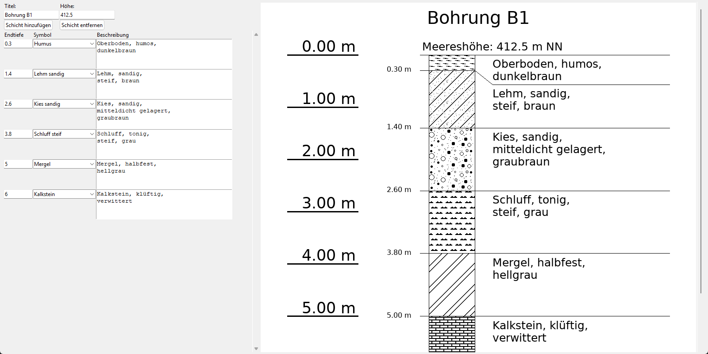

# Bohrprofil

[](https://github.com/add-IV/bohrprofil/actions/workflows/ci.yml)

Kleines Desktop-Programm zum Zeichnen von Bohrprofilen. Man trägt die Schichten
mit Endtiefe, Bodenart und Beschreibung ein, und das Profil wird maßstäblich
daneben gezeichnet. Das Ergebnis lässt sich als PNG oder PDF exportieren oder
direkt drucken.



## Download

Eine fertige Windows-Version gibt es unter
[Releases](https://github.com/add-IV/bohrprofil/releases/latest). Zip
entpacken und `Bohrprofil.exe` starten, eine Installation ist nicht nötig.

## Benutzung

Über *Datei → Öffnen* kann `examples/beispiel.json` geladen werden. Tiefen
dürfen mit Komma oder Punkt eingegeben werden. Die Schichten werden beim
Zeichnen nach Tiefe sortiert, die Reihenfolge der Eingabe ist also egal.

Die Schraffuren sind einfache PNG-Kacheln im Ordner `patterns/`. Der Dateiname
ist gleichzeitig der Name in der Auswahlliste, eigene Muster können also einfach
dazugelegt werden.

Abstände, Schriftgrößen, Farben und Linienstärken stehen in `config.ini` und
können auch im Programm unter *Optionen → Konfigurieren* geändert werden. Was
welcher Wert bedeutet, zeigt [docs/layout.png](docs/layout.png). Längen ohne
Einheit sind Pixel bei 300 DPI, mit `cm` dahinter Zentimeter.

## Entwicklung

Benötigt Python 3.12 oder neuer.

```bash
pip install -r requirements.txt
python app.py
```

Tests und Linter:

```bash
pip install -r requirements-dev.txt
pytest
ruff check .
```

`python build.py` baut mit Nuitka eine eigenständige Windows-Version nach
`dist/app.dist/`. Bei einem `v*`-Tag macht das der Release-Workflow auf GitHub
und hängt das Zip an das Release.

Das Zeichnen (`src/draw.py`) ist von der Oberfläche getrennt und arbeitet nur
mit Pillow. Die Tkinter-Oberfläche sammelt die Eingaben in ein
`Bohrprofil`-Objekt (`src/bohrprofil.py`), daraus wird bei jeder Änderung ein
neues Bild gerendert. Den PDF-Export schreibt `src/export.py` selbst (ein
JPEG auf einer A4-Seite), damit keine PDF-Bibliothek nötig ist.

## Lizenz

Alle Rechte vorbehalten. Die mitgelieferte Schrift DejaVu Sans steht unter
der [DejaVu-Fonts-Lizenz](https://dejavu-fonts.github.io/License.html).
